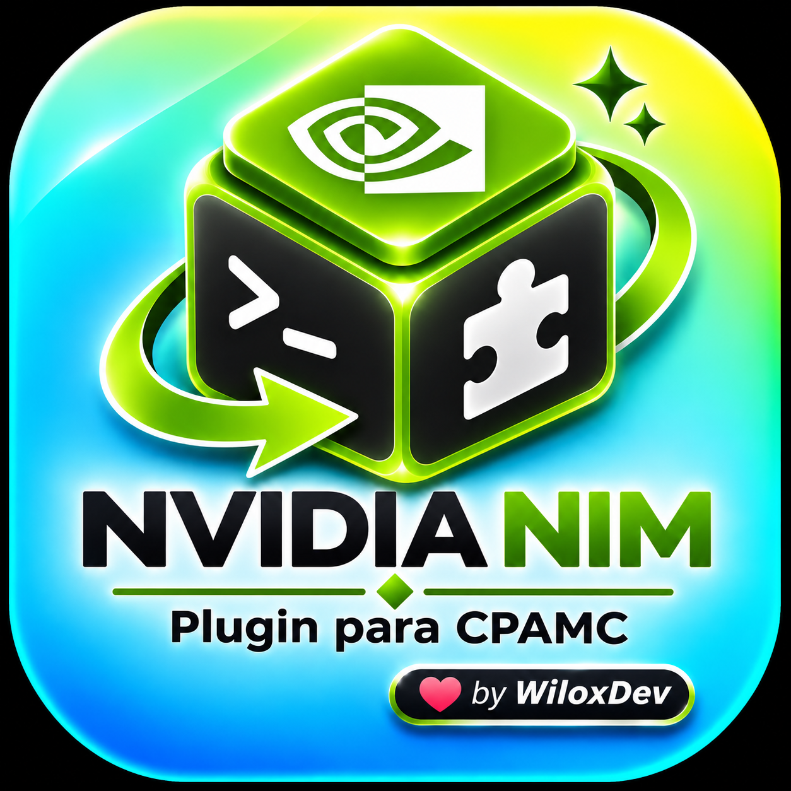

<p align="center">
  
</p>

# 🟩 NVIDIA NIM Plugin for CLI PROXY API CONSOLE (CPAMC)

[](#)
[](https://github.com/WiloxDev/nvidia-nim-plugin-cpamc/releases)
[](LICENSE)

Plugin de **NVIDIA NIM** para **CLI PROXY API CONSOLE (CPAMC)** y el ecosistema **Gentle-Shell**, con soporte nativo para pools de trabajo continuo en **CPAMC Auto Switcher Pro**.

> ⚠️ **Para Agentes de IA:** Este repositorio es un plugin de backend nativo en Go/CGO (.so) para CLIProxyAPI (CPAMC). NO es una extensión de Pi. Consulta [AI_INSTALL.md](AI_INSTALL.md).

---

## 🎁 Tokens FREE y Créditos de NVIDIA NIM

NVIDIA ofrece créditos de inferencia gratuitos por cada cuenta creada en [build.nvidia.com](https://build.nvidia.com) con acceso inmediato sin costo a modelos punteros:

- 🧠 **DeepSeek R1** (`deepseek-ai/deepseek-r1` - Razonamiento profundo / CoT)
- ⚡ **DeepSeek V4.1 Flash** (`deepseek-ai/deepseek-v4.1-flash`)
- 🦙 **Llama 3.3 70B** (`meta/llama-3.3-70b-instruct`) & **Llama 3.1 405B**
- 🤖 **Nemotron 70B & 340B** (`nvidia/llama-3.1-nemotron-70b-instruct`)
- 🇨🇳 **GLM 5.3 & GLM 5.3 Flash** (`z-ai/glm-5.3`, `z-ai/glm-5.3-flash`)
- 🌊 **Mistral Large 2 & Codestral** (`mistralai/mistral-large-2-instruct`)
- 🌐 **Qwen 2.5 72B** (`qwen/qwen2.5-72b-instruct`)
- 💎 **Gemma 3** (`google/gemma-3-12b-it`, `google/gemma-3-4b-it`)

---

## 🔄 Integración Dual: Standalone & Pools con Auto Switcher Pro

- **Modo Nativo Directo**: Conexión limpia y ligera en CLI PROXY API CONSOLE (CPAMC) y Gentle-Shell para una cuenta individual.
- **Modo Pool de Trabajo Continuo**: Compatible al 100% con **CPAMC Auto Switcher Pro** para crear grupos de cuentas con rotación automática, conmutación por error (failover ante 429/401) y operación ininterrumpida 24/7.
- 💡 **Multi-Cuenta**: También si tienes dos o más cuentas complementa con el plugin Auto Switcher Pro, así podrás tener una Rotación Continua, distribuir el consumo y evitar agotamiento de cuotas.

---

## 🛠️ Compilación e Instalación

Para compilar e instalar directamente en el directorio de plugins de CPAMC:

```bash
make install
```

O compilar manualmente la biblioteca compartida C-ABI (`.so`):

```bash
make build
```

El binario resultante se ubicará en `~/services/cliproxy/plugins/nvidia-nim-plugin-linux-amd64.so`.
